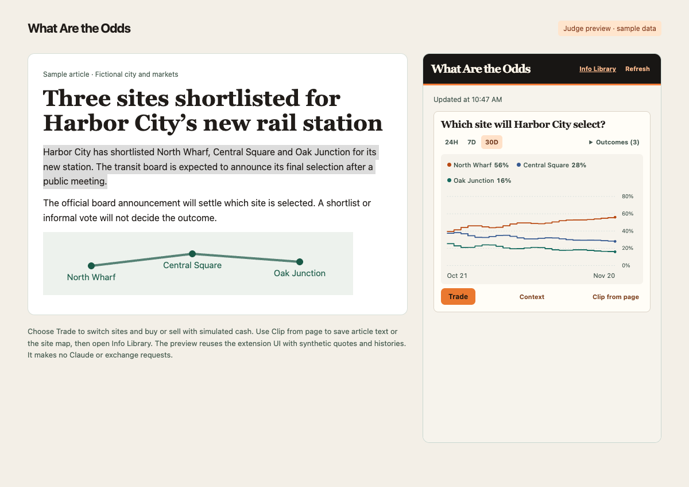

# Headline Odds

Headline Odds is a Chrome extension that finds prediction markets related to the article you are reading. It puts price history, the latest odds, and the settlement rules alongside the story.

Built for the University Blockchain Conference Hackathon 2026. See the [submission handoff](docs/SUBMISSION.md) for the proposed track, Gemini integration and remaining eligibility requirements.

## Try it

### Judge preview without credentials

With Node.js 22 or newer, run `npm run demo` from this directory and open [the local judge preview](http://127.0.0.1:4178/). There are no npm dependencies to install. The demo uses the actual popup renderer and a clearly labelled fictional article with sample data. Range switching, outcome selection and the Context view work without external requests.



### Chrome extension with live markets

1. Open `chrome://extensions`, enable **Developer mode**, select **Load unpacked**, and choose this repository folder.
2. Open a regular news article. Click the Headline Odds toolbar icon, open **Settings**, and save your own Anthropic API key. Live matching uses Anthropic API credits. The Anthropic organization must allow direct browser requests.
3. Open Headline Odds on the article. Choose **24H**, **7D**, or **30D** to change the chart. The legend above the chart shows each outcome and its latest odds. The percentage scale runs down the right. **Outcomes** selects up to five plotted contracts.
4. Select **Context** to read a short article connection and settlement excerpt, including source links where available. Select **Back to odds** or press Escape to return.
5. Click a name in the legend to open its demo ticket. Choose **Yes** or **No**, enter a dollar amount and buy or sell. Each browser profile starts with $1,000 in simulated cash. Orders fill at the displayed reference probability (or its complement for No) and persist locally. Open positions show their marked value and, when recorded, the weighted average entry price.
6. Choose **Clip from page** on a market. Highlight text and press **Save text**, or click an image to save its visible portion. **Info Library** shows saved markets with chart snapshots. Open a market for sourced key points, upcoming events mentioned in the evidence, settlement criteria, and the original passages or images. The library uses local IndexedDB and needs no account.
7. Use **Refresh** for fresh exchange data. The extension can reuse a recent Claude match judgment for identical candidate details within one hour.

## Architecture

```text
Article tab
  └─ article.js · Read a bounded excerpt when the popup opens
       └─ background.js · Manifest V3 service worker and lookup cache
            ├─ lookup.js / claude.js · Extract questions and judge market relevance
            ├─ gemini.js / polymarket.js · Search events and normalize outcomes
            └─ history.js · Retrieve, normalize and cache price histories
                 └─ popup.js / chart.js · Render markets, ranges, latest odds and full context
```

- **Matching.** Claude extracts unresolved questions and search terms. Both venues are searched in parallel. Candidates are shortlisted by event and outcome relevance, then reviewed for a matching event, condition, and timeframe. A direct answer to the article’s main question ranks above a secondary match. Gemini wins a relevance tie.
- **Gemini integration.** Headline Odds uses Gemini Prediction Markets event search for market discovery and contract quotes, and Gemini instrument candles for chart history. Polymarket public market search and historical prices provide a second source. The extension displays probabilities from exchange price data and links to the provider’s available rules or source.
- **Rendering and cache.** The extension sends quotes to the popup before history is ready. Article matches stay fresh for ten minutes, or one minute after a partial venue search. Exchange search results and history are reused across articles for 90 seconds and five minutes, respectively. The history cache is keyed by venue, instrument and chart range. The display takes the latest exchange price when available, with the last observation from the default window as fallback.
- **Privacy.** Chrome grants page access when the user opens the extension. The live lookup sends the headline, publication date if available and up to 5,000 characters of readable article text to Anthropic. Gemini and Polymarket receive search terms and instrument identifiers. The API key is stored in the Chrome profile and sent to Anthropic to authenticate requests. Match snapshots, including selected quoted evidence, are cached locally. The full article excerpt is discarded after matching.
- **Scope.** Market discovery, quotes and charts are read-only. The extension uses exchange HTTP APIs. Direct blockchain reads, wallets, order execution and chain awards are outside this build.

## Verification

Run `npm run check` and `npm test` with Node.js 22+. Run `npm run verify:gemini` for a credential-free check of live Gemini event search and chart history. Market availability changes. See the [dated Gemini check](docs/GEMINI_VERIFICATION.md) and [demo walkthrough](docs/DEMO.md).

[Gemini event search](https://developer.gemini.com/rest-api/prediction-markets/events/list-events) · [Gemini candles](https://developer.gemini.com/trading/rest-api/market-data/list-candles) · [Polymarket event list](https://docs.polymarket.com/api-reference/events/list-events-keyset-pagination) · [Polymarket batch history](https://docs.polymarket.com/api-reference/markets/get-batch-prices-history)
